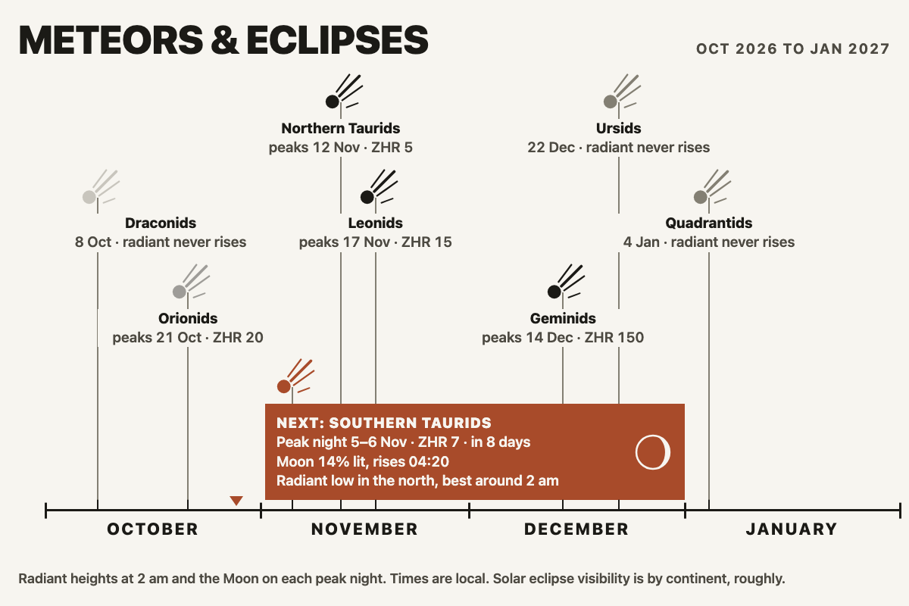
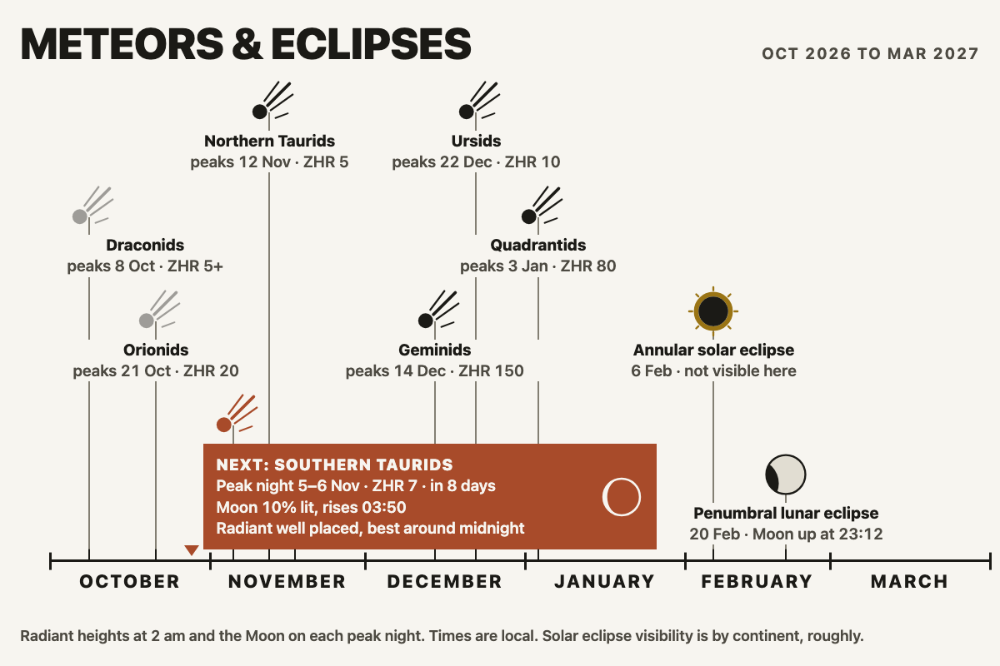
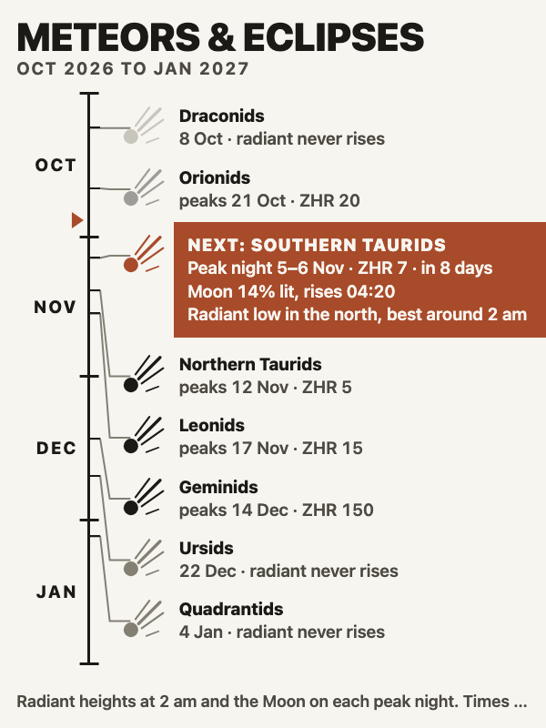
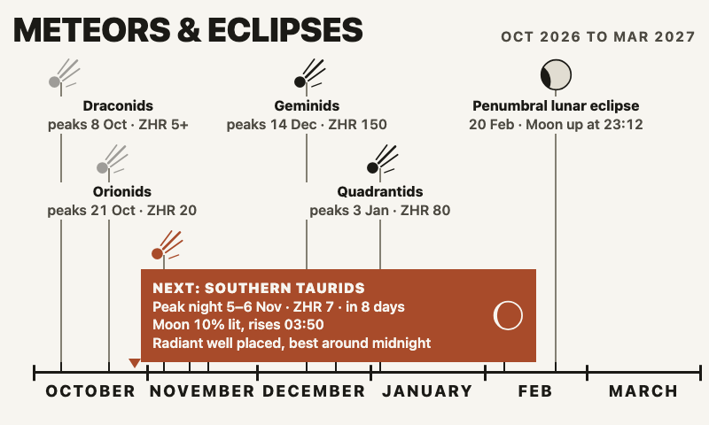
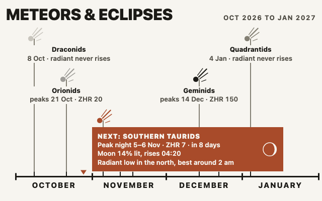
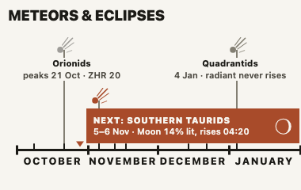
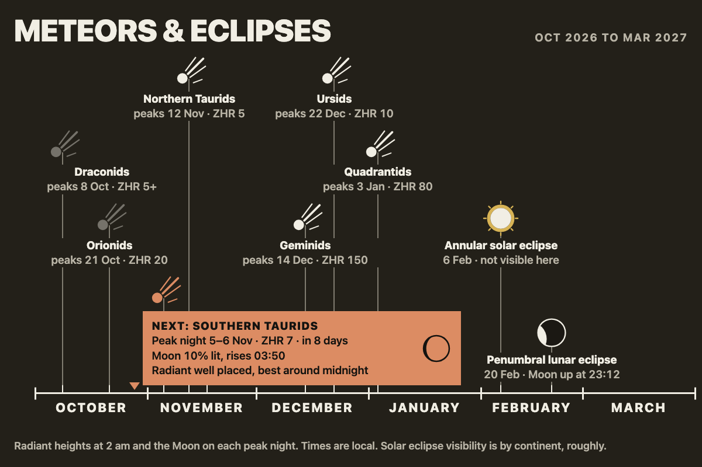
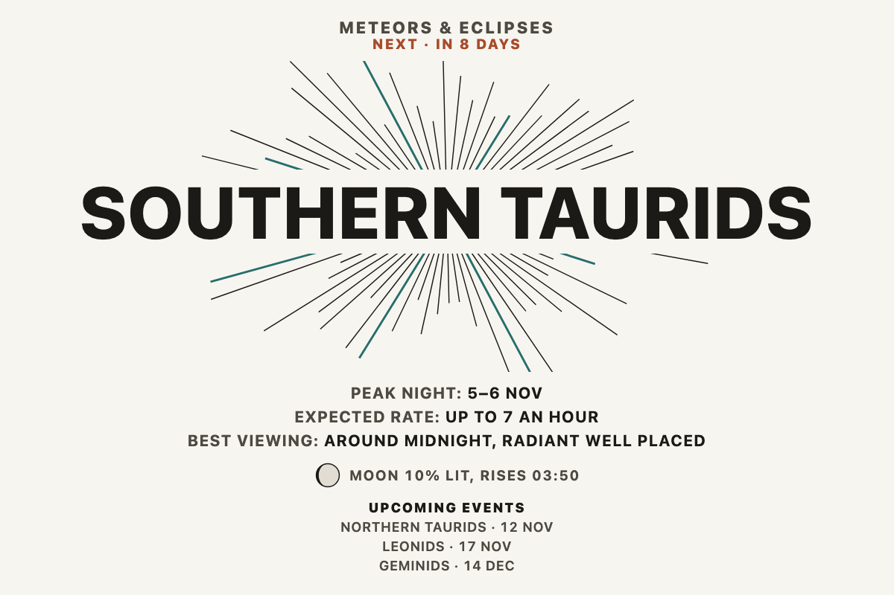

# meteors_eclipses

The meteor showers and eclipses coming up, worked out for the place the
panel is in: when each shower peaks, how many meteors to expect, when to
look, how high the radiant climbs, and how much the Moon will get in the
way. Lunar eclipses are checked against your horizon and solar eclipses
against your continent.



## No key, no network

There is no API behind this. The shower list and the eclipse table are
bundled, and every local detail is computed on the spot with a small
ephemeris, so it works on a Tesserae with no internet and costs nothing to
run. `requires` is empty and `needs_network` is false.

## What it shows

Each **meteor shower** carries its peak night, its ZHR (the hourly rate
under a perfect dark sky with the radiant overhead, so the number you will
see is lower), and for your place:

- where the radiant sits at 2 am local on the peak night: "well placed",
  "low in the north", "below the horizon";
- the best hour to look, which is the dark hour between 10 pm and dawn when
  the radiant is highest, or "before dawn" if it is still climbing;
- the Moon on the peak night: how much of it is lit and whether it is up
  between midnight and 4 am, as "Moon 72% lit, rises 22:40" or "No
  moonlight".

Each **eclipse** carries NASA's time of greatest eclipse in your local
clock. A lunar eclipse is "visible" when the Moon is above your horizon at
that moment. A solar eclipse is visible when NASA's region of visibility
includes your continent, which is worked out from latitude and longitude
with a coarse lookup; it tells you partial phases reach your part of the
world, not that you are on the central line.


## Two layouts

**Timeline** draws the coming months on one rule, starting from the first of
this month, with a comet glyph above each shower's peak and a disc for each
eclipse (shaded for lunar, a dark disc with a bright rim for solar). The
next event sits in a solid colour box with the Moon's phase and a line on
the radiant. Captions take lanes when they would collide; on a small cell
the minor showers keep their tick on the rule and lose their caption. Past
events in the current month are drawn faint. In a portrait cell the rule
runs down the left with the months beside it.

**Next event** is one shower large, with its radiant as a burst of lines
behind the name, then the peak night, the expected rate, the best hour, the
Moon, and the three events after it. When the next event is an eclipse the
burst gives way to the eclipse disc.

The `xs` tile shows only the next event's name and how many days away it is.

## Screenshots



London over six months. The Quadrantids are well placed here and the
Ursids rise; from Melbourne neither radiant clears the horizon.



Portrait: the rule runs down the left and captions are nudged apart, each
joined to its true date by an elbow.



An 800 by 480 panel keeps three lanes of captions.



A half panel, `md`.



A small card, `sm`: two lanes and a two-line next-event box.


The `xs` tile: the next event and the days to go.



The dark theme, London, six months.



The editorial style in the next-event layout.

## Options

Place, layout, eclipses and the visibility filter are always shown; the
month count appears for the timeline, and the title sits under **More
options** (Tesserae 0.473 and later; an older Tesserae shows them all).

| Option | Notes |
| --- | --- |
| Place | Where the sky is watched from. Falls back to the app-level location. |
| Layout | Timeline, or next event. |
| How many months | Timeline only. 3, 4 or 6 months from the first of this month. |
| Eclipses | Solar and lunar eclipses alongside the showers. |
| Only what is visible from here | Hides showers whose radiant never rises, lunar eclipses with the Moon below the horizon, and solar eclipses that miss this continent. |
| Title | More options. The heading; empty hides it. |

## Where the data comes from, and its limits

**Showers** follow the International Meteor Organization's 2026 Meteor
Shower Calendar (Rendtel, IMO INFO(3-25)), Table 5, the Working List of
Visual Meteor Showers: thirteen of the annual showers, with activity
period, maximum as a solar longitude, radiant and ZHR as printed there,
plus the parent body where it is known. Because the maximum is kept as a
solar longitude the peak lands on the right night in any year, not only in
2026. The IMO revises the list every year; ZHRs are typical recent values
and a shower can do better or worse. The Draconids are marked variable.

**Eclipses** are NASA's decade tables (Espenak and Meeus, Five Millennium
Canon, as summarised at eclipse.gsfc.nasa.gov) for 2026 to 2030: twelve
solar and twelve lunar. The time of greatest eclipse is converted from
Terrestrial Dynamical Time to UT with a flat 69 seconds, then to the local
clock. The table ends with 2030; after that the widget shows showers only
until it is updated.

**The sky** is computed, not fetched. Sun and Moon positions use Paul
Schlyter's low-precision method, which is good to a few arcminutes for the
Sun and a fraction of a degree for the Moon: plenty to call the horizon,
the phase and a radiant's altitude, and nowhere near enough to predict an
eclipse, which is why those come from NASA.

**Visibility is modelled, not observed.** "Well placed" is geometry, not
weather. Solar eclipse visibility is a continent lookup from coarse
latitude and longitude boxes, so islands and borderlands can land on the
wrong side of a line; the panel says it is approximate. Lunar eclipse
visibility is the Moon's altitude at greatest eclipse only, so an eclipse
that begins before moonrise and ends after is still "visible" if the Moon
is up at the middle.

**Time zones.** A geocoded place carries its zone. Pasted coordinates do
not, and with no network nothing can be looked up, so the server's own zone
is used when it is plausible for the longitude, and otherwise a whole-hour
solar offset, which can be an hour out at the edge of a zone.

## Install

Settings, Widgets, Browse, or drop the folder into `plugins/meteors_eclipses/`.

## Tests

```sh
python -m pytest tests -q
```

The tests pin the full Moon of 2026 March 3, the Moon's altitude from
Melbourne and London at that eclipse, every 2026 maximum against the IMO's
printed dates, the Geminid radiant from Melbourne and Reykjavik, the
next-event picker across a year end, eclipse visibility from both
hemispheres, the continent lookup, and that `fetch()` returns data or an
error dict without raising.

## Licence

AGPL-3.0. See [LICENSE](LICENSE). Shower data from the
[International Meteor Organization](https://www.imo.net/) 2026 Meteor
Shower Calendar; eclipse data from
[NASA GSFC](https://eclipse.gsfc.nasa.gov/) (Fred Espenak). The ephemeris
follows Paul Schlyter's
[How to compute planetary positions](https://stjarnhimlen.se/comp/ppcomp.html).
